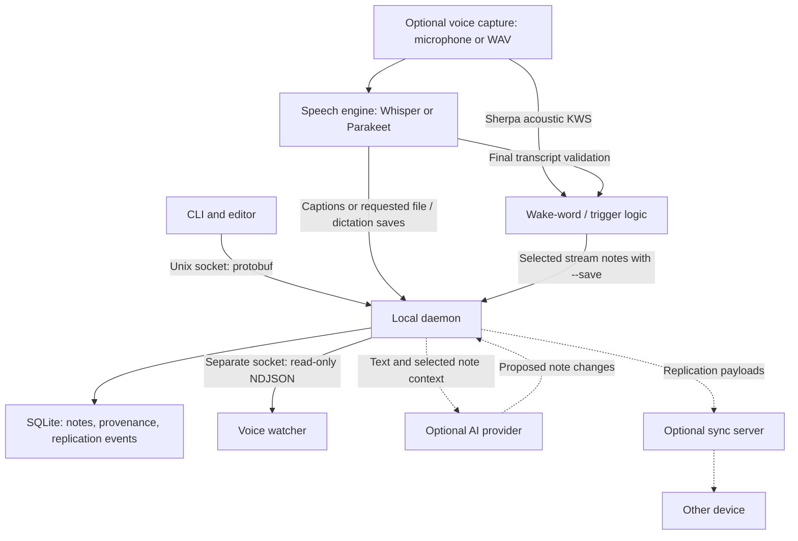

# GinkGo

A local-first journaling CLI written in Go, inspired by
[jrnl](https://github.com/jrnl-org/jrnl). Write Markdown notes, organize them with
tags and namespaces, and search from the terminal. Sync, voice capture, and AI
processing are optional.

## Install and start

Build on Linux with Go 1.24.2 or newer, Git, and `make`. Microphone capture also
requires PipeWire.

```sh
git clone https://github.com/iMithrellas/GinkGo.git
cd GinkGo
make build
export PATH="$PWD/build:$PATH"
```

Arch users can install the [AUR package](https://aur.archlinux.org/packages/ginkgo-cli)
with `yay -S ginkgo-cli`.

For a new installation, create the configuration and initialize a namespace from
an interactive terminal:

```sh
ginkgo-cli config generate
ginkgo-cli config namespace init -n default
ginkgo-cli config check
```

Skip generation if a config file already exists. See [configuration](docs/config.md)
for paths and overrides, and [sync](docs/sync.md) before setting up shared
encryption keys.

Start the daemon in one terminal:

```sh
GINKGO_HTTP_ADDR=127.0.0.1:7465 ginkgo-cli daemon
```

This sets a loopback address for the daemon's health listener. Choose a free port
and leave the process running. In another terminal, add the same `build/` directory
to `PATH` and create a note:

```sh
ginkgo-cli note add "Started my journal" --tags journal
ginkgo-cli note list --output plain
ginkgo-cli note show NOTE_ID
```

Use the same configuration for both processes. Connection and startup errors are
covered in [configuration](docs/config.md).

<details>
<summary>Install binaries, man pages, and a user service</summary>

```sh
make lsp
make install-binary
export PATH="$HOME/.local/bin:$PATH"
make install-man
```

Binary installation creates symlinks into the checkout, including `ginkgod` for
the daemon and `ginkgo-lsp` for editor completion. Keep the checkout in place.
Man-page installation requires `gzip`; `mandb` is optional. `make install` builds
both binaries and installs them with the man pages.

To use systemd, set a loopback `http_addr` in your [configuration](docs/config.md),
then stop the foreground daemon and run:

```sh
make install-service
systemctl --user daemon-reload
systemctl --user enable --now ginkgo.service
```

For other session managers, start `ginkgod` from session startup.

</details>

## Guides

| Task | Guide |
| --- | --- |
| Write, edit, search, export, and inspect original input | [Notes](docs/usage.md) |
| Set paths, namespaces, environment overrides, and daemon listeners | [Configuration](docs/config.md) |
| Connect devices, run a server, and configure encryption | [Sync](docs/sync.md) |
| Configure a provider and generate or expand notes | [AI notes](docs/ai.md) |
| Transcribe files, dictate, or record wake-selected notes | [Voice](docs/voice.md) |

The [documentation index](docs/README.md) includes the command reference and
developer documentation. Use `ginkgo-cli COMMAND --help` for flags in your build.

## Architecture



Provider and sync requests may leave the machine. Local storage and export
handling are covered in [Notes](docs/usage.md); replication encryption is covered
in [Sync](docs/sync.md).

## Development

See [CONTRIBUTING.md](CONTRIBUTING.md) for build and test commands,
[internals](docs/internals.md) for data and lifecycle contracts, and
[issue #1](https://github.com/iMithrellas/GinkGo/issues/1) for the roadmap.
